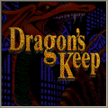

<!-- markdownlint-disable-file MD033 -->

# Full Tilt! Pinball for Android

[](https://github.com/zakkyhidayat/ftpinball-android/actions/workflows/android.yml)

Play the three tables of **Full Tilt! Pinball** on your Android phone:

| | Table | Rules |
| --- | --- | --- |
|  | **Space Cadet** | Complete, as in the original game |
|  | **Dragon's Keep** | Re-implemented from the original game's code and help file |
|  | **Skulduggery** | Re-implemented from the original game's code and help file |

The app does not include the game's data, because it is copyrighted. You add it from your own copy of the game (see below).

## Install

1. Download the latest APK from the [Releases page](https://github.com/zakkyhidayat/ftpinball-android/releases) and install it. Android will ask you to allow installs from your browser or file manager.
2. Put your copy of Full Tilt! Pinball on the phone, in any folder you like. You need the folder that holds the `CADET`, `DRAGON` and `PIRATE` folders (on the original CD it is `WIN95/FULLTILT`). Copying the whole disc also works. It is about 19 MB.
3. Open the app and tap **Choose your Full Tilt! folder**. The game reads the files from their folder, so Android first asks you to allow the app to read your storage (switch on "All files access" for the app and come back). Then choose your game folder.
4. The app lists the tables it found, and they appear in the menu. The files are **not copied**: they stay where you put them, so keep that folder on your phone.

If a table is missing from the menu, the app could not find its `.DAT` file in the folder you chose. Choose the folder one level up, or the folder of that table. If you move or delete the folder, choose it again.

## Playing

- Touch controls with haptic feedback; hold the shoot button to charge the plunger.
- A top 10 high score list for each table, with name and date. Scores of games that used cheats are not recorded.
- Sound effects and music each have an on/off switch and a volume slider.
- Confirmation before you restart a game or go back to the menu.

## How complete are the rules?

Space Cadet follows the original rules fully. For Dragon's Keep and Skulduggery the scoring, quests and modes, multiballs, bonus and sounds are rebuilt from the original game's code. They do not cover every part yet, mainly light shows and some light-based effects. [The component guide](docs/TABLE_COMPONENTS.md) lists what each table part does and what is and is not done.

## Build it yourself

You need JDK 17 or newer and the Android SDK (platform 34, build-tools 34.0.0, NDK 26.3.11579264, CMake 3.22.1).

```bash
git clone --recursive https://github.com/zakkyhidayat/ftpinball-android
cd ftpinball-android
echo "sdk.dir=$HOME/Android/Sdk" > local.properties
./gradlew installDebug   # with a phone connected over adb
```

To build an APK that already contains your own game data, stage it first. Never share an APK built this way.

```bash
tools/stage_fulltilt.sh /path/to/FULLTILT   # the folder holding CADET, DRAGON and PIRATE
```

This copies the data into the git-ignored `app/fulltilt-assets/`.

## Project layout

| Path | Contents |
| --- | --- |
| `app/` | The Android app (Java): menu, settings, high scores, touch controls |
| `app/src/main/cpp/` | JNI bridge and the CMake build of the engine and SDL |
| `SpaceCadetPinball/` | The pinball engine (C++), table components and the table rules in `control.cpp` |
| `tools/` | Helper scripts |
| `docs/` | Documentation |

More: [table component guide](docs/TABLE_COMPONENTS.md) and [CONTRIBUTING.md](CONTRIBUTING.md).

## Licence

MIT, see [LICENSE](LICENSE). Full Tilt! Pinball and its data belong to their owners and are not part of this project.
